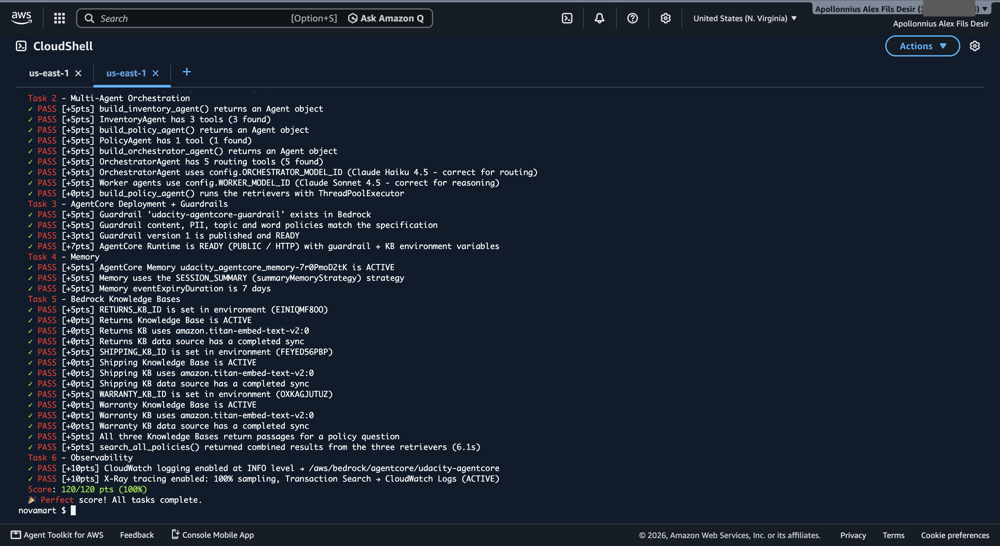
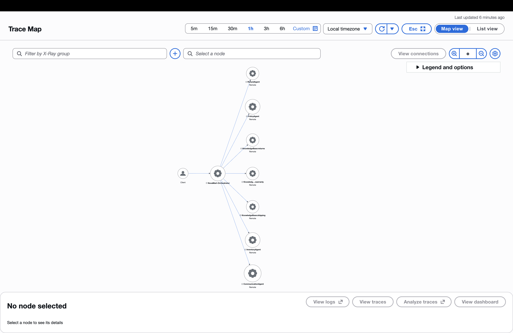

# Multi-Agent E-commerce RAG — Amazon Bedrock AgentCore

A production-shaped customer support system for a fictional e-commerce store, NovaMart,
built on **Amazon Bedrock AgentCore** and the **Strands Agents SDK**. Submitted for the
Udacity *Future AWS Agent Engineer* nanodegree (course `cd14764`). Scores **120/120** on
the project's automated test suite.

Five agents in an Orchestrator → Workers hierarchy handle a support request end to end:
classify the intent, gather order facts, decide refund eligibility, answer policy
questions from three knowledge bases in parallel, and compose the reply the customer
actually reads.

## Architecture

```
                         Customer request
                                │
                    ┌───────────▼────────────┐
                    │   OrchestratorAgent    │   Claude Haiku 4.5, temp 0.0
                    │   routes + owns state  │   deterministic routing
                    └───────────┬────────────┘
                                │
        ┌───────────────┬───────┴───────┬────────────────┐
        ▼               ▼               ▼                ▼
  InventoryAgent   PolicyAgent    RefundAgent    CommunicationAgent
   (DynamoDB)     (multi-agent    (eligibility   (drafts the reply)
    temp 0.1          RAG)          + DynamoDB)       temp 0.3
                        │            temp 0.1
         ┌──────────────┼──────────────┐
         ▼              ▼              ▼
   ReturnsRetriever ShippingRetriever WarrantyRetriever    temp 0.0
        (KB)             (KB)              (KB)
         └───── ThreadPoolExecutor(max_workers=3) ─────┘

        Shared state: DynamoDB WorkflowState, optimistic locking
```

All four workers run Claude Sonnet 4.5. Every routing tool reads `WorkflowState`, invokes
its worker, and writes the result back with an `expected_version` condition, so two agents
can never silently overwrite each other.

## What each piece does

| Component | Responsibility |
|---|---|
| `OrchestratorAgent` | Six routing rules; never writes the customer-facing reply itself |
| `InventoryAgent` | `check_order_status`, `get_customer_tier`, `list_customer_orders` — reports facts, makes no decisions |
| `RefundAgent` | Reads inventory findings from `WorkflowState`, applies the tier's window (Standard 30 days, Premium 60), processes the return |
| `PolicyAgent` | Fans out to three retriever sub-agents in parallel, synthesises one grounded answer |
| `CommunicationAgent` | Reads the full `WorkflowState` and writes the single message the customer receives |

## Routing rules

| # | Trigger | Path |
|---|---|---|
| 1 | Every request | `initialize_session` first |
| 2 | Order status / return / refund | Inventory → Refund |
| 3 | Policy meaning questions | Policy (3 parallel KB retrievers) |
| 4 | Account questions ("am I premium?") | Inventory — never Policy, which has no customer data |
| 5 | Pure arithmetic | Straight to Communication, skipping the rest |
| 6 | Every request, last | Communication composes the reply |

## Results

All six test groups pass — 120/120.

| Task | Points | What it covers |
|---|---:|---|
| 2 — Multi-agent graph | 40/40 | Five agents, tool counts, model assignment, `ThreadPoolExecutor` fan-out |
| 3 — Runtime + Guardrails | 20/20 | Guardrail policies, published version, runtime READY with env vars |
| 4 — Memory | 15/15 | `SESSION_SUMMARY` strategy, 7-day event expiry, ACTIVE |
| 5 — Knowledge Bases | 25/25 | Three KBs on Titan v2 + S3 Vectors, all synced, parallel retrieval |
| 6 — Observability | 20/20 | CloudWatch INFO logging, X-Ray at 100% sampling |



The X-Ray Service Map of a live request, showing the orchestrator fanning out to every
worker and knowledge base:



## Three things worth knowing

**Parallel RAG is the whole point of the PolicyAgent.** Three retriever sub-agents, each
bound to one knowledge base, dispatched through `ThreadPoolExecutor(max_workers=3)` and
collected with `as_completed()`. Wall time is the slowest knowledge base, not the sum —
about 4.6s for all three against roughly triple that if run in sequence. The coordinator
never retrieves anything itself; it only synthesises what comes back.

**The guardrail has to distinguish haggling from arithmetic.** The project requires a
DENY topic for "pricing negotiations", but a naive definition also blocks the legitimate
scenario *"how much are 5 items at $29.99 with 10% off?"*. The definition here scopes the
topic to changing an advertised price and explicitly carves out calculation using an
already-specified price and discount, so the math request is answered rather than refused.

**Agents that report facts and agents that make decisions should be separate.** The
InventoryAgent's system prompt forbids the words "eligible" and "approved" as conclusions
of its own; it states the order date and today's date and stops. The RefundAgent does the
arithmetic and owns the verdict. Splitting them this way keeps a wrong eligibility call
traceable to exactly one agent.

## Running it

```bash
# 1. Foundation stack (DynamoDB, S3, S3 Vectors, IAM, CloudWatch)
aws cloudformation deploy --template-file infrastructure/starter_stack.yaml \
    --stack-name udacity-agentcore --capabilities CAPABILITY_NAMED_IAM --region us-east-1
python infrastructure/seed_data.py

# 2. Three Bedrock Knowledge Bases (Titan Embed v2 + S3 Vectors), IDs into .env
# 3. Guardrail, runtime, memory, observability
python src/agent_orchestrator.py deploy

# Local run with a live trace
python src/agent_orchestrator.py test
python src/agent_orchestrator.py chat

# Grade it
python tests/test_agent.py all
```

Requires Python 3.12+, Node.js 20+ and `uv` (the AgentCore CLI needs both). The starter
scaffolding — `config.py`, `agent_utils.py`, `agent_observability.py`,
`bedrock_kb_retrieval.py`, `agentcore_cli.py`, the CloudFormation template and the test
suite — comes from the [course repository](https://github.com/udacity/cd14764-aws-agentic-c3-classroom);
`agent_orchestrator.py` in this repo is the implementation.

## A note on redaction

The AWS account ID is blacked out in the screenshots. Resource identifiers that remain
visible (Knowledge Base IDs, guardrail ID, runtime name, memory ID) are account-scoped and
require IAM credentials to reach — there is no unauthenticated endpoint in this
architecture. `.env` is gitignored; `.env.example` shows the shape.

Tear the stack down when you are finished with it:

```bash
python infrastructure/cleanup.py          # dry run
python infrastructure/cleanup.py --yes
```
